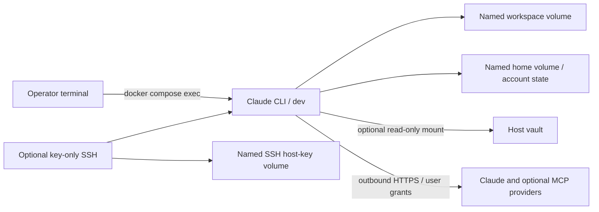

# Container architecture and boundaries

DockerCatAgent provides one Debian-based interactive Claude Code environment. Compose is the runtime source of truth. There is no HTTP application, scheduler, hosted control plane or agent orchestration.

## Image and process model

[`Dockerfile`](../Dockerfile) installs Debian packages and Claude Code from Anthropic's signed Debian repository, verifies the published signing-key fingerprint and runs `claude --version` during build. The package channels are mutable; signing verifies package origin, not that future builds are identical. [Reproducibility](maintenance.md#build-reproducibility) remains a separate concern.

The image includes Git, tmux, SSH tools, shell editors and a baseline build/Python toolchain. It does not include Obsidian desktop, Docker Engine or a remote IDE server. Additional toolchain profiles are roadmap candidates.

`tini` is the entrypoint supervisor. The default command is `sleep infinity`, keeping a terminal container available for `docker compose exec`. [`scripts/healthcheck.sh`](../scripts/healthcheck.sh) checks directories and command availability. Healthy means those prerequisites exist; it does not mean Claude is authenticated, an API is available, storage has been backed up or an interactive session is alive.

## Compose profiles and overlays

| Configuration | Effect | Boundary |
| --- | --- | --- |
| `compose.yml` | Non-root development shell, persistent home/workspace, resource limits | No published ports or host-path mounts |
| `compose.ssh.yml` with base | SSH daemon and authorized public keys, host-key volume, host port | Explicit root daemon; login shells remain `dev` |
| `compose.obsidian.yml` with base | Existing vault at `/vault` | Read-only host bind mount |
| `compose.obsidian-write.yml` with base | Existing vault at `/vault` | Explicit write permission; choose instead of read-only overlay |
| `compose.portainer.yml` | Image-only base stack | Image must exist on the selected endpoint |

Keep the same overlay set on `config`, `up`, `exec`, `stop` and `down` commands. Validate the merged configuration before recreating a service. SSH and a vault can be combined when both are intentionally enabled. Do not combine both vault overlays and rely on merge order to choose safety.

## Storage and identity

| Path | Storage | Purpose |
| --- | --- | --- |
| `/workspace` | Named `workspace` volume | Source repositories and working files |
| `/home/dev` | Named `home` volume | Shell configuration, Claude state, user-local MCP configuration and credentials |
| `/etc/ssh/dockercat-hostkeys` | Named `ssh_hostkeys` volume in SSH mode | SSH server identity |
| `/home/dev/.ssh/authorized_keys` | Read-only bind file in SSH mode | Public keys allowed to log in |
| `/vault` | Optional host bind mount | User-selected Obsidian vault |

`dev` has UID and GID 1000. Both the image and base Compose configuration select it. Host bind mounts must grant that identity appropriate access; container root in SSH mode does not make normal `dev` shells root. Avoid recursive changes to host data permissions to make a mount work.

Default capabilities are dropped and `no-new-privileges` is enabled. SSH mode adds `SETUID`, `SETGID`, `CHOWN`, `DAC_OVERRIDE`, `FOWNER`, `SYS_CHROOT` and `NET_BIND_SERVICE` for startup, privilege separation and login under `dev`, and runs its daemon as root inside the container. Its additional privilege surface is tracked by [SSH boundary issue #9](https://github.com/thetechbenders/DockerCatAgent/issues/9) and requires explicit validation; it does not change the baseline service automatically.

## Authentication-state lifecycle

1. The first clean home has no account login or user-local MCP authorization.
2. The account holder configures and authenticates inside a `dev` session. Claude may write `.claude.json`, files under `.claude/`, and version-dependent state elsewhere in home.
3. Recreating the image/container with the same home volume preserves those files. It does not refresh expired tokens or guarantee that a provider still authorizes access.
4. An update may change configuration format. Keep a protected pre-upgrade backup and perform account-holder acceptance after recreation.
5. Logging out or removing an MCP definition may not revoke provider-side grants. Revoke unwanted access through the provider and follow its current credential-removal guidance.

Do not mount an existing host's entire home directory or copy personal configuration into the image. Use a dedicated persistent container home and [generic instructions](personal-instructions.md).

## Filesystem and network trust

The base exposes no host ports and mounts only its named volumes. It uses ordinary container networking with outbound access; no egress allowlist is implemented. Optional SSH defaults to host loopback, while its daemon listens inside the container. Reachability from a remote client requires a deliberately selected trusted private/VPN interface or an outer host tunnel.

Read-only mounts prevent filesystem writes, not reading or disclosure. Agent-executed code can use accessible network services and files. Docker administrators can inspect volumes, processes and credentials. Agent prompts and tmux view modes are convenience controls rather than isolation boundaries. See the [security model](security.md) and [architecture decisions](architecture-decisions.md).
